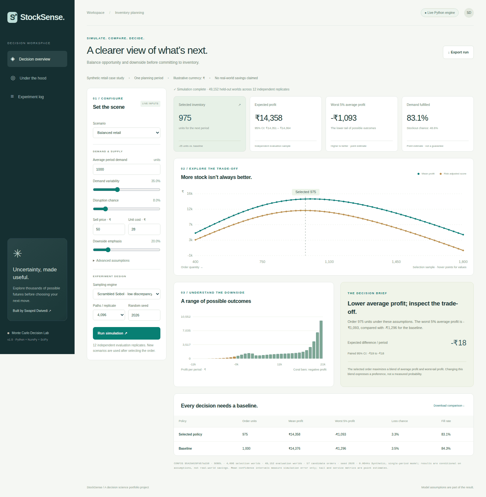

<div align="center">

# StockSense
### Monte Carlo Decision Lab

**Turn uncertainty into an inventory decision you can explain.**

Python · NumPy · SciPy · Monte Carlo · SQL · Statistical validation


[Quick start](#run-in-three-steps) · [Study guide](docs/STUDY_GUIDE.md) · [Model specification](docs/METHODOLOGY.md) · [Interview kit](docs/INTERVIEW_KIT.md)

</div>



## The business question

A retailer must order inventory before knowing demand or whether a supplier will deliver in full. Ordering too little loses sales; ordering too much creates expensive leftovers. **Which order quantity offers a sensible balance between average profit and bad outcomes?**

StockSense simulates demand and supply, compares 57 candidate orders, selects a policy, and evaluates it on fresh simulated worlds. An interactive dashboard makes the assumptions and trade-offs visible. A SQLite ledger retains the full experiment.

This is an original educational portfolio implementation with synthetic data. It is not a production procurement system, a historical backtest, or evidence of realized business savings. AI assistance was used in development and documentation; the numerical behavior is checked with explicit tests and an analytic oracle.

## Run in three steps

Requires Python 3.11-3.13. Run these commands from the repository root.

```bash
git clone https://github.com/Swapnil-byte-798/stocksense-monte-carlo-lab.git
cd stocksense-monte-carlo-lab
python -m venv .venv
# macOS/Linux
source .venv/bin/activate
# Windows PowerShell instead: .venv\Scripts\Activate.ps1

python -m pip install -e .
python -m stocklab serve
```

Open **http://127.0.0.1:8000**. Change a scenario, run the simulation, explore the charts, download the result, and inspect the experiment log. There are no API keys, paid services, external datasets, or frontend build steps.

For a headless run:

```bash
python -m stocklab run --method sobol --n 4096 --replicates 12 --seed 2026
python -m unittest discover -s tests -v
```

## A result worth discussing

The committed [default run](examples/default-run.json) uses 4,096 selection paths and **49,152 held-out paths across 12 independent evaluation replicates**. Sobol points within a replicate are deliberately dependent.

| Metric | Selected: 975 units | Baseline: 1,000 units |
|---|---:|---:|
| Expected profit per period | ₹14,357.78 | ₹14,376.21 |
| Average profit in worst 5% of outcomes | −₹1,093.24 | −₹1,295.84 |
| Probability of a loss | 3.30% | 3.53% |
| Unit-weighted demand fulfilled | 83.14% | 84.26% |

The risk-sensitive policy gives up about **₹18.43 in average profit** for about **₹202.59 better worst-tail profit**. It also fulfills less demand. This is a preference trade-off, not an unconditional improvement. The paired 95% Monte Carlo interval for the average-profit difference is approximately **[−₹18.63, −₹18.24]**. It measures numerical uncertainty under the model, not uncertainty about the real world.

## What makes the project substantive

| Capability | Evidence in the repository |
|---|---|
| Business problem formulation | Profit identity, cost contract, explicit risk preference, baseline comparison |
| Statistical modeling | Lognormal demand, Bernoulli disruption, Gaussian copula dependence |
| Simulation engineering | Seeded NumPy generators, scrambled Sobol sampling, common random numbers |
| Honest evaluation | Independent selection/evaluation streams; replicate-level intervals; point-estimate labels for tail risk |
| Mathematical verification | Hand calculations and a closed-form newsvendor oracle, including a deterministic limit |
| Data engineering | Strict CSV calibration, SHA-256 provenance, indexed SQLite experiment history, analytical SQL |
| Product delivery | Responsive dashboard, JSON API, CLI, CSV/JSON exports, validation and useful errors |
| Reproducibility | Pinned numerical dependencies, version/seed metadata, evidence generation script, CI configuration |

## Reproduce the evidence

```bash
python scripts/reproduce.py
python -m stocklab calibrate examples/synthetic-demand.csv
python -m stocklab run --config examples/scenario.json
```

The evidence script regenerates the default run, a nine-case sensitivity study, synthetic demand data, and a fixed-policy sampling benchmark. In the no-disruption analytic benchmark, at 4,096 paths over 24 replicates, the observed RMSE was **76.09 for ordinary Monte Carlo and 0.425 for scrambled Sobol**. This is a measured result for this low-dimensional benchmark, not a universal performance claim. See [benchmark.json](examples/benchmark.json).

For SQL exploration, use a SQLite client with JSON support:

```bash
sqlite3 -header -column output/experiments.db < sql/analysis.sql
```

Optional container:

```bash
docker build -t stocksense .
docker run --rm -p 127.0.0.1:8000:8000 stocksense
```

The built-in HTTP server is for local demonstrations. Public deployment needs authentication, a production gateway, quotas, and operational monitoring. Container and CI configurations are provided; consult [validation](docs/VALIDATION.md) for what was actually executed.

## Explore the project

```text
stocklab/        Numerical model, experiments, calibration, ledger, CLI, HTTP API
stocklab/web/    Buildless dashboard and a reproducible saved preview
tests/          Numerical invariants and integration checks
examples/       Synthetic data and generated experiment evidence
notebooks/      An executable journey from simulation basics to model validation
scripts/        Reproduce experiments and validate the browser interface
sql/            Experiment analysis using SQL and window functions
docs/           PRD, FRD, architecture, methodology, study guide, interview kit
```

| Start here | Purpose |
|---|---|
| [Study guide](docs/STUDY_GUIDE.md) | Basics to advanced, 2-3 sentence analogies, equations, exercises, answer key |
| [Notebook](notebooks/01_monte_carlo_lab.ipynb) | Run and modify the concepts interactively |
| [PRD](docs/PRD.md) / [FRD](docs/FRD.md) | Product problem, scope, requirements, acceptance criteria |
| [Architecture](docs/ARCHITECTURE.md) | Module boundaries, data flow, complexity, engineering trade-offs |
| [Methodology](docs/METHODOLOGY.md) | Exact definitions, assumptions, statistical limitations |
| [API and operations](docs/API_AND_RUNBOOK.md) | API contract, local setup, troubleshooting, deployment boundaries |
| [Interview kit](docs/INTERVIEW_KIT.md) | Demonstration script, defensible resume bullets, questions and answers |

## Boundaries and next experiments

The model covers one item and one period, continuous demand and inventory, fixed prices, prepaid orders without shortfall refunds, and known parameters. It does not model seasonality, replenishment timing, parameter uncertainty, censored sales, multi-item budgets, or a real supply chain. A narrow Monte Carlo interval cannot validate those assumptions.

The next meaningful extensions are a censored-demand model, parameter bootstrap, multi-period replenishment, and evaluation against genuine historical decisions. They are roadmap items, not implemented features. See the study guide for how to approach them.

MIT License · Built by [Swapnil Dwivedi](https://github.com/Swapnil-byte-798).
