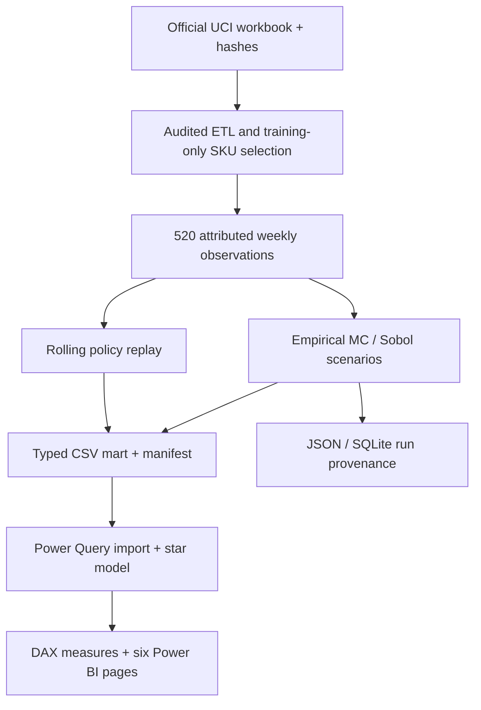

# Architecture · Python engine, native Power BI presentation

| Component | Ownership |
|---|---|
| `preparation.py`, `prepare_retail.py` | Hash verification, optional Excel ETL, exclusion audit, SKU choice and calendar |
| `retail.py` | Derived checksum, product allowlist, empirical scenarios and chronological replay |
| `model.py`, `experiment.py` | Accounting, MC/Sobol worlds, lower-tail objective, independent paired evaluation |
| `ledger.py`, `cli.py` | Reproducible commands, complete JSON and queryable SQLite summaries |
| `export_powerbi.py` | Twelve typed CSVs, scenario cube, policy curves, histograms and hashes |
| `build_powerbi.py` | Native PBIP/PBIR report, TMSL model, Power Query imports, DAX and theme |
| `configure_powerbi.py` | Local absolute DataFolder parameter setup after clone |
| `validate_powerbi.py` | Offline official schema checks, field references, relationships, hashes/grains/accounting |
| `powerbi/` | Native report/model source, bundled imports, walkthrough and DAX reference |

Product and week selection never uses future test outcomes. Policy replay is separate from final-refit simulation. Product/scenario/week dimensions filter facts in one direction; incompatible scenarios are not summed into one decision KPI. DAX handles reporting context, not Monte Carlo random generation. Scenario selection is deterministic inspection of Python-generated results.

No Node/browser stack is needed. Report files contain no data cache or credentials. Native JSON schemas are cached for CI; Power BI Desktop remains the execution/rendering authority for M and DAX.
