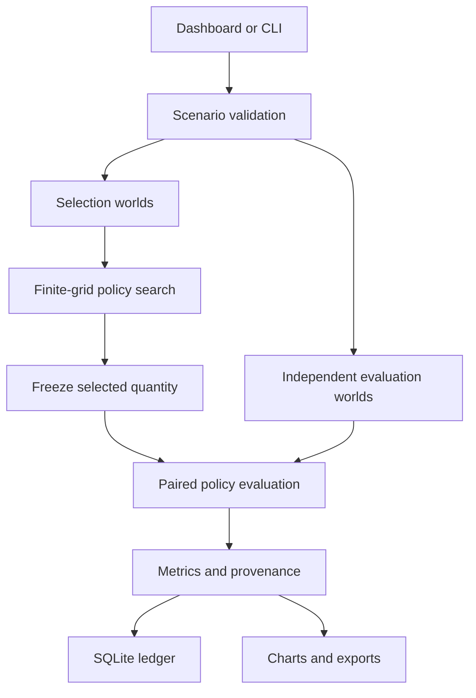

# Architecture and engineering decisions

## Boundaries

`model.py` contains deterministic transforms and RNG-local sample generators. It does not open files, change global random state, or serve HTTP. `experiment.py` owns stream allocation, policy selection, evaluation, and provenance. `ledger.py` persists completed runs with parameterized SQL. `calibration.py` converts a narrowly defined CSV into demand parameters. `cli.py` and `server.py` adapt the engine to different interfaces. The frontend presents Python results and does not implement a second numerical model.

This separation allows numerical verification without starting a server, API tests without a real database, and new presentation layers without rewriting the statistics.

## Decisions and trade-offs

| Decision | Reason | Cost / boundary |
|---|---|---|
| NumPy + SciPy | Clear array math, tested probability transforms and Sobol implementation | Numerical version pinning matters |
| Buildless HTML/CSS/JS | A reviewer can run everything without Node or a frontend build | Charts and interactions are maintained directly |
| Standard-library HTTP server | Small local demonstration with no framework dependency | Not a production web stack; public hosting needs a gateway and stronger controls |
| SQLite + complete JSON | Auditable local experiments with useful SQL | One-user workload; no shared analytics warehouse |
| Search one policy at a time | Avoid a large candidates × paths outcome matrix | Repeats array operations for each candidate |
| Independent evaluation | Prevents evaluating a selected policy only on the sample that selected it | More simulation work; does not address parameter/model error |
| Replicate-level inference | Works consistently for MC and independent Sobol scrambles | Approximate intervals depend on replicate-mean behavior |
| Pinned numerical versions | Better reproducibility of transformations and generators | Updates require rerunning reference checks |

## Complexity and resource model

For K candidate orders, N selection paths, and R evaluation replicates, scenario generation is O(N + RN). Tail sorting makes selection approximately O(K N log N); mean evaluation is O(RN), and pooled tail summaries add O(RN log(RN)). Working memory is O(N + RN), not O(KN), because each candidate is evaluated separately. Evaluation arrays are retained for pooled tail and histogram outputs.

The API caps N at 16,384, R at 32, K at 121, body size at 16KB, and concurrent simulations at one. These caps bound ordinary demo workload; they are not a substitute for internet-facing rate limiting or connection limits.

## Data and provenance

- Synthetic CSV data is generated with a separate fixed seed and a known distribution.
- Calibration stores a SHA-256 of the exact CSV bytes. It does not claim fit diagnostics or causal validity.
- Each completed result records configuration, root seed, child seeds, Python/NumPy/SciPy versions, engine version, and UTC execution time.
- Configuration hashes intentionally exclude timestamps. Equal hashes indicate equal requests, not necessarily identical environments.
- SQLite stores full JSON plus typed summary columns and an index on configuration ID.
- A new run appends a row; previous experiments are never overwritten.

## Production evolution

Replace the local HTTP adapter with an authenticated application service and a bounded job queue. Add per-user quotas, request timeouts, structured error logging, a production reverse proxy, TLS, durable database backups, and model/version governance. Introduce these only when serving multiple users; none is claimed as implemented in v1.
